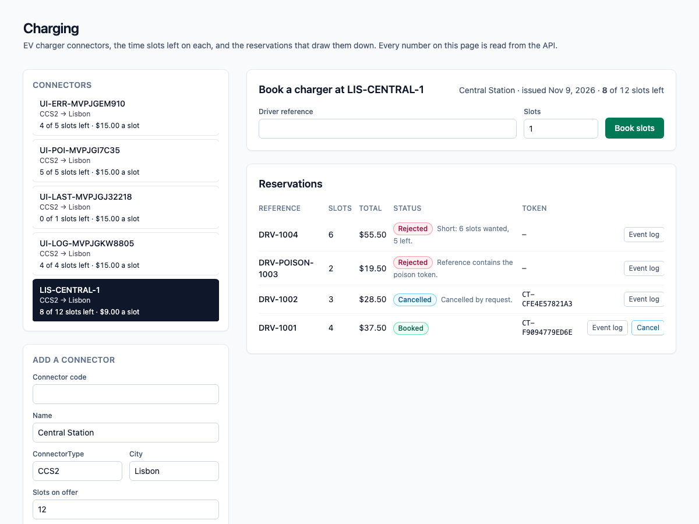
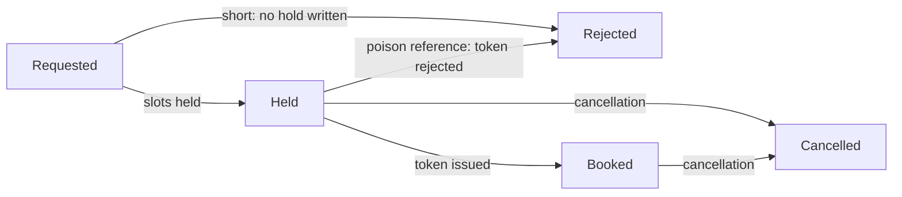
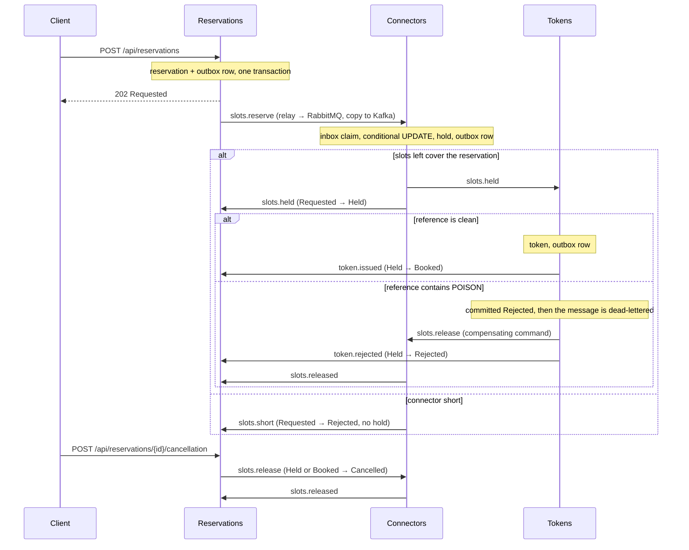

# dotnet-charging

EV charger connectors, the time slots left on each, and the reservations that draw them down. The scarce number is the **slots left** on a connector (half-hour windows on one service date), and the **Connectors** module is its only writer: it holds slots with a single conditional `UPDATE` that matches only while the slots left still cover the reservation, so when two drivers fight for the last slot, one commits a hold and the other is told the connector is short and no hold is written. A driver reference that contains the poison token `POISON` is committed as rejected by the Tokens module, the message is dead-lettered, and a compensating command gives the slots back. A later cancellation also gives the slots back, but it does not roll back the charging-session token that was already issued.

One ASP.NET Core process, one Postgres database. An HTTP write saves the reservation and an outbox row in one local transaction; a `BackgroundService` relay publishes outbox rows to RabbitMQ (the work queue) and Kafka (the event log); the next module consumes from RabbitMQ, claims an inbox key in the same transaction as its own write, and writes its own row and outbox row. Saga steps never call each other in-process. Delivery is at-least-once: the relay can publish and crash before it marks a row sent, so the row goes out again, and every consumer dedupes with its inbox key. Each saga step only moves a reservation forward from the status it expects.

> The Compose network is local and unauthenticated. There is no login, no token-as-proof and no cookie. Do not publish these ports; Compose binds all of them to `127.0.0.1`.



*The UI reads everything from the API. Shown: a booked reservation, a cancellation that gave 3 slots back and kept its token, a reservation rejected for the poison token, and one that was short.*

## What this models, and what it does not

EV charging platforms distinguish a booking for a future window from an instant hold on a connector, and a connector that looks free when a driver checks can be taken by the time they arrive, which is why advance reservations exist. The OCPP protocol has a Reservation profile, but not every charger implements it, so the backend has to enforce availability itself. This repository models the backend half: a connector offers a number of bookable slots for a service date, and a reservation takes some of them. It does not talk to chargers, start sessions, meter energy or model no-shows. The token it issues is the record that a reservation was confirmed, not a credential for a charger.

## Money

Prices are whole cents on the connector. A reservation costs slots × the connector's price per slot, plus a flat session fee of 150 cents, so four slots at $9.00 cost $37.50. A reservation is 1 to 8 slots (up to four hours). The arithmetic is `checked`: it throws instead of wrapping.

## Reservation statuses



`Cancelled` and `Rejected` (after a hold) give the slots back through a `ReleaseSlots` command, and Connectors releases a hold at most once. The token has its own status (`Issued` or `Rejected`) and a cancellation never changes it. If the cancellation gets there before the final mark, the late mark finds the reservation is no longer `Held` and does nothing.

## How the modules talk



| Module | Owns | Consumes | Emits |
| --- | --- | --- | --- |
| **Reservations** (`Modules/Reservations`) | `Reservations`: status, slots, total, driver reference. Validation, the poison rule, the total. | `slots.held`, `slots.short`, `token.issued`, `token.rejected`, `slots.released` | `slots.reserve`, `slots.release` (cancellation) |
| **Connectors** (`Modules/Connectors`) | `Connectors.SlotsLeft` (sole writer after the connector opens) and `SlotHolds`. | `slots.reserve`, `slots.release` (prefetch 1) | `slots.held`, `slots.short`, `slots.released` |
| **Tokens** (`Modules/Tokens`) | `Tokens`. | `slots.held` | `token.issued`, `token.rejected`, `slots.release` (poison) |
| **Messaging** (`Messaging`) | `OutboxMessages`, `InboxMessages`, the relay, the consumer loop with retry and dead-letter, the Kafka log. | | |

RabbitMQ topology is declared in code (`Messaging/Topology.cs`): exchange `charging.work`, one queue per module (`connectors.commands`, `tokens.work`, `reservations.events`), a `.retry` queue per module (2 s TTL, then back to the main queue, 3 attempts), and a `.dlq` per module behind `charging.dlx`. A transient failure retries; a poison message goes straight to the dead-letter queue after its rejection is committed. Kafka has one topic, `charging.events`, one partition, replication factor 1, keyed by reservation id.

## Run it

Needs Node 22 (npm 10), .NET SDK 10.0.401 (`global.json`), Docker (arm64 is fine) and python3 for the smoke script.

```bash
npm ci
docker compose up -d --wait db        # dotnet test uses Postgres on 5479 (database charging_test)
dotnet test tests/api/Charging.Api.Tests.csproj
docker compose up --build --wait      # db, kafka, rabbitmq, api, web
./scripts/smoke.sh                    # last line: charging smoke passed
npx playwright install chromium       # once
npx playwright test                   # two specs against http://127.0.0.1:8099
docker compose down                   # keeps the Postgres volume; `down -v` drops it
```

| Service | Host port |
| --- | --- |
| Web (nginx, proxies `/api/`) | 8099 |
| API (`/scalar/v1`, `/api/health`) | 5219 |
| Postgres 17 | 5479 |
| Kafka 3.8.1 (KRaft, one broker) | 9129 |
| RabbitMQ 3.13 / management UI (`platform` / `platform`) | 5709 / 15709 |

Inside the Compose network the API and nginx listen on 8080 and Kafka's internal listener is 9092.

## Try it with curl

```bash
curl -s -X POST http://127.0.0.1:5219/api/connectors \
  -H 'content-type: application/json' \
  -d '{"code":"LIS-CENTRAL-1","name":"Central Station","connectorType":"CCS2","city":"Lisbon","slotsTotal":12,"priceCents":900}'

curl -s -X POST http://127.0.0.1:5219/api/reservations \
  -H 'content-type: application/json' \
  -d '{"connectorCode":"LIS-CENTRAL-1","reference":"DRV-1001","slots":4}'
# 202, status Requested, totalCents 3750. Use the returned id:

curl -s http://127.0.0.1:5219/api/reservations/<id>            # Booked after a few seconds, with a token number
curl -s http://127.0.0.1:5219/api/tokens/<id>
curl -s http://127.0.0.1:5219/api/connectors/LIS-CENTRAL-1     # slotsLeft 8
curl -s http://127.0.0.1:5219/api/reservations/<id>/events     # the Kafka log for this reservation

curl -s -X POST http://127.0.0.1:5219/api/reservations/<id>/cancellation \
  -H 'content-type: application/json'                          # slots come back; the token stays
```

A reservation is validated at the door: driver reference required (at most 40 characters), 1 to 8 slots. The poison match is a case-sensitive substring: `DRV-POISON-7` and any longer token containing `POISON` match.

## Develop with Nx

The repository is an Nx workspace (`nx.json`, plugin `@nx/dotnet`). `npx nx show projects` lists `api` (the ASP.NET Core monolith), `web` (the Angular app) and the inferred xUnit project.

```bash
docker compose up -d --wait db kafka rabbitmq   # the brokers and Postgres, not the app
npx nx serve api                                # http://localhost:5219
npx nx serve web                                # http://localhost:4299, proxies /api to the API
WEB_URL=http://localhost:4299 npx playwright test   # the same browser specs, against the dev servers
npx nx run-many -t typecheck lint -p web        # tsc --noEmit and ESLint (angular-eslint)
npx nx build web && npx nx build api            # what CI builds
```

## What is tested, and where it runs

- **xUnit against real Postgres** (`tests/api`, 26 tests): two tasks with two `DbContext`s fight for one remaining slot (one `Held`, one `Short`, slots left 0, no hold for the loser); empty input, over-limit input, integer overflow (4294967297 must not wrap to 1), the total and its checked arithmetic, the poison substring; the same message delivered twice is claimed once; a release returns the slots once; the poison rejection is committed before the dead-letter; a cancellation followed by the late final mark leaves the reservation `Cancelled` and the token `Issued`. The race test was run against a read-then-write version of the hold, where it failed, and against the conditional update, where it passes.
- **`scripts/smoke.sh`** drives the composed stack with a run id on every code, so a kept volume does not collide: validation, the happy path (total, token, Kafka log), three concurrent reservations for one slot (one booked, two short, no hold for the losers), the poison reference (rejected, `tokens.work.dlq` gains one message, slots restored), and a cancellation that lands between the token and the final mark (reservation `Cancelled`, token `Issued`, slots back, second cancellation `409`). To make that last window wide enough to hit on purpose, Compose sets `Reservations__FinalMarkDelayMs=1500`; it is a latency knob and defaults to 0.
- **Playwright** (`e2e/specs/book-slots.spec.ts`): adds a connector in the UI, books slots, sees `Booked` and the token number, reloads to prove the page reads the API and keeps nothing in `localStorage`, then cancels and sees the slots come back. A second spec, `e2e/specs/ui-flows.spec.ts`, drives the page through the refusal messages (over-limit, empty reference, duplicate), the poison rejection, the loser of a race for the last slot, and the Kafka event log panel. Both specs pass against the Compose stack and against the Nx dev servers.
- **CI** (`.github/workflows/ci.yml`, on push) has two jobs. `verify`: `npm ci`, Prettier check, `dotnet format whitespace --verify-no-changes`, `dotnet test` with a Postgres 17 service, `nx typecheck` and `nx lint` for web (ESLint with angular-eslint, template accessibility rules included, zero warnings allowed), and `nx build` for web and api. `e2e`: builds the Compose stack on the runner, runs `scripts/smoke.sh` and both Playwright specs against it, uploads the Playwright traces and prints the Compose logs on failure.

## API

All routes are unauthenticated JSON. Interactive docs are at `http://127.0.0.1:5219/scalar/v1` (OpenAPI at `/openapi/v1.json`); the web port proxies `/api/`, `/scalar/` and `/openapi/` too.

| Method and path | What it does | Responses |
| --- | --- | --- |
| `GET /api/health` | Liveness. | `200 Healthy` |
| `POST /api/connectors` | Opens a connector with its slots on offer (1 to 96) and a price in cents per slot. | `201`, `400` invalid, `409` code exists |
| `GET /api/connectors` | Lists connectors. | `200` |
| `GET /api/connectors/{code}` | One connector with the live slots left. | `200`, `404` |
| `POST /api/reservations` | Accepts a reservation (1 to 8 slots) and starts the saga. | `202` Requested, `400` invalid, `404` unknown connector, `409` duplicate reference |
| `GET /api/reservations?connectorCode=` | Lists the latest 100 reservations, optionally for one connector. | `200` |
| `GET /api/reservations/{id}` | One reservation and its status. | `200`, `404` |
| `POST /api/reservations/{id}/cancellation` | Moves a held or booked reservation to `Cancelled` and gives the slots back. The token is not touched. | `202`, `404`, `409` wrong status |
| `GET /api/reservations/{id}/events` | The Kafka event log for one reservation, read from the start of the topic. | `200` |
| `GET /api/tokens/{reservationId}` | The token row. | `200`, `404` until the step has run |

Errors come back as `application/problem+json` with a `title`.

## Configuration

Compose sets these on the API container. Defaults in `apps/api/appsettings.json` point at the published host ports, so `nx serve api` works against `docker compose up -d --wait db kafka rabbitmq`.

| Setting | Compose value | Meaning |
| --- | --- | --- |
| `ConnectionStrings__Charging` | `Host=db;Port=5432;Database=charging;Username=charging;Password=charging` | The one Postgres database. Migrations run on startup. |
| `RabbitMq__Host` / `__Port` / `__User` / `__Password` | `rabbitmq` / `5672` / `platform` / `platform` | Work queue. Virtual host `/`. |
| `Kafka__BootstrapServers` | `kafka:9092` | Event log. |
| `Reservations__FinalMarkDelayMs` | `1500` | Milliseconds the final mark waits. A latency knob so the smoke can land a cancellation inside the window. `0` outside Compose. |
| `CHARGING_TEST_DB` (tests only) | | Postgres connection for `dotnet test`. Defaults to `localhost:5479`, database `charging_test`. CI points it at its service container. |

## Look inside and fix things

```bash
docker compose ps                      # five services, all healthy
docker compose logs -f api             # relay, consumers, poison and retry lines
docker compose exec db psql -U charging -d charging -c 'select "RoutingKey","SentAt" from "OutboxMessages" order by "Id" desc limit 10'
open http://127.0.0.1:15709            # RabbitMQ management, platform / platform
```

- **Dead-lettered messages** sit in `tokens.work.dlq`. Nothing replays them; inspect them in the management UI. Retries wait in `<queue>.retry` for 2 seconds.
- **A port is already in use**: `lsof -nP -i :5219` shows who holds it. Compose publishes only on `127.0.0.1`.
- **`dotnet test` cannot connect**: start Postgres first with `docker compose up -d --wait db`.
- **The smoke cannot reach the API**: run `docker compose up --build --wait` first; override the target with `API=... RABBIT=... ./scripts/smoke.sh`.
- **Start clean**: `docker compose down -v` drops Postgres, Kafka and RabbitMQ data. Plain `down` keeps them, and the smoke is safe on kept data because every code carries a run id.
- **The Kafka log looks empty right after a reservation**: the relay publishes within a second or so; reload the event log.

## Known limits

- It is unauthenticated on purpose. Anything that can reach the API can read and write everything.
- It models bookable slots, not chargers: no OCPP, no sessions, no energy metering, no no-show or grace-period handling, no multi-connector chargers that share power, and no hold that expires while a driver is paying.
- Delivery is at-least-once, not exactly-once. The inbox makes repeats harmless for the saga; the Kafka log can hold a duplicate event after a relay crash.
- One broker, one partition, replication factor 1, one API instance. The relay does not coordinate across instances (the inbox would absorb the duplicates, but the outbox is never trimmed).
- `GET .../events` scans the whole topic for each call. Fine here, not something to expose at scale.
- Lists are capped at 100 rows and not paginated.
- Dead-lettered messages are not replayed automatically.
- The browser specs drive Chromium at a desktop size only, and the `e2e` CI job needs Docker and takes a few minutes.

## Cloud mapping

This repository runs on Compose. Nothing in it calls a cloud account.

| Here | On AWS |
| --- | --- |
| Postgres 17 | RDS for PostgreSQL |
| Kafka 3.8 | MSK |
| RabbitMQ 3.13 | Amazon MQ, or SQS with a dead-letter queue |
| The API and the web app | ECS or App Service |

## Layout

```
apps/api      ASP.NET Core monolith: Modules/{Reservations,Connectors,Tokens}, Messaging, Data, Migrations
apps/web      Angular 21, styled with Tailwind 4 utilities only
tests/api     xUnit against Postgres
e2e/          Playwright
scripts/      smoke.sh
compose.yaml  Postgres, Kafka, RabbitMQ, API, web
```

Nx 23.2.1 orchestrates `nx build web`, `nx lint web`, `nx typecheck web` and `nx build api`; EF Core migrations are committed and the API applies them on startup.

## Other systems in this .NET track

- [dotnet-freight](https://github.com/joshbarros/dotnet-freight): container space on ocean sailings.
- [dotnet-clinic](https://github.com/joshbarros/dotnet-clinic): appointment slots in a provider session.
- [dotnet-ledger](https://github.com/joshbarros/dotnet-ledger): outgoing payments from an account balance.
- [dotnet-warehouse](https://github.com/joshbarros/dotnet-warehouse): warehouse stock and outbound orders.
- [dotnet-academy](https://github.com/joshbarros/dotnet-academy): course cohort seats and enrollments.
- [dotnet-compute](https://github.com/joshbarros/dotnet-compute): GPU-hour reservations in a pool.
- [dotnet-hotel](https://github.com/joshbarros/dotnet-hotel): hotel room-nights.
- [dotnet-tickets](https://github.com/joshbarros/dotnet-tickets): event ticket tiers and orders.
- [dotnet-carbon](https://github.com/joshbarros/dotnet-carbon): carbon credit batches and purchases.
